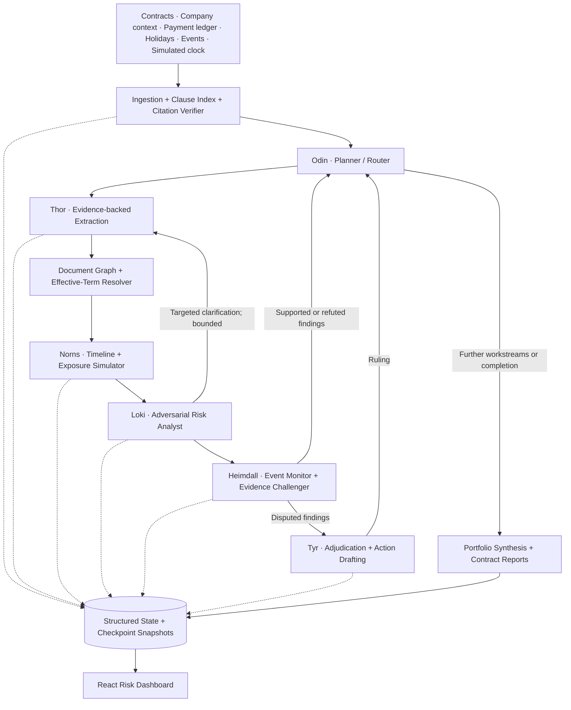

# ODIN — Autonomous Contract Intelligence Engine

> **Beyond contract summaries. From static legal documents to a living, evidence-backed risk radar.**

**Hackathon:** Quillhub Autonomous Contract Intelligence Challenge — *Trial of the Nine Realms*  
**Project status:** Architecture roadmap. A working local runtime milestone is documented in [RAGNAROK_RUNTIME.md](RAGNAROK_RUNTIME.md); the multi-agent system described below remains a target.

The implemented runtime currently provides durable tasks, local memory, Ollama-backed or deterministic evidence-checked finding runs, contract text ingestion, and staged operational event imports. Its finding status confirms source quotes and headings, not legal conclusions. See the [implementation plan](docs/IMPLEMENTATION_PLAN.md) for the exact boundary between working code and planned features.

## The Problem

Growing SaaS companies sign cloud-hosting, customer, security, and contractor agreements at different times. Individually, each contract may look reasonable; together, they can produce conflicting promises, missed deadlines, non-recoverable financial exposure, and compliance gaps. An ordinary LLM summary does not reliably track amendments, simulate future dates, connect operational events to contractual duties, or challenge its own conclusions.

Our solution is **ODIN**, a multi-agent contract intelligence platform for the fictional company **Quillhub Inc.**, operator of the Route Optimizer SaaS platform. ODIN is designed to ingest a contract portfolio, reconstruct relationships between documents, track obligations across simulated dates, test possible risks adversarially, and recommend traceable actions for human review.

## Our Core Idea

**Every important finding must be explainable:**

`Source clause → Extracted fact → Effective contractual term → Event/timeline → Risk hypothesis → Evidence challenge → Verified finding/ruling → Recommended action`

Instead of asking one LLM to “summarize everything,” we divide responsibilities among specialized agents and deterministic services. The agents operate on **shared structured state**, not on unverified conversational memory.

## System Architecture



### The Six Agents

| Agent | Responsibility | Expected output |
|---|---|---|
| **Odin — Orchestrator** | Plans per-contract and cross-contract workstreams; routes retries and disputes; enforces budgets and completion rules | Workstream plan, transitions, final synthesis |
| **Thor — Extractor** | Extracts parties, dates, obligations, SLA promises, liability limits, notice rules, and source citations; flags ambiguity instead of guessing | Structured facts with exact quotes, clause IDs, confidence, status |
| **Norns — Timekeeper** | Applies effective dates, payment history, notice periods, cure windows, holidays, and simulated clock checkpoints | Deadline timeline, scenario analysis, exposure estimates |
| **Loki — Challenger** | Searches for loopholes, inconsistent terms, weak evidence, amendment errors, and unrecoverable customer commitments | Risk hypotheses and targeted clarification requests |
| **Heimdall — Watcher** | Maps operational events to impacted clauses; independently supports or refutes Loki’s claims | Event-linked evidence, alert candidates, finding status |
| **Tyr — Arbiter** | Resolves agent disagreements with traceable reasons; creates draft notices and action proposals | Rulings, recommended actions, human-approval flags |

**Design rule:** Agents reason; deterministic code verifies source text, computes dates where rules are unambiguous, performs ledger checks, and enforces workflow limits. A finding is never made trustworthy merely because multiple agents agree.

## Proposed Technology Stack

| Layer | Technology | Why |
|---|---|---|
| Multi-agent orchestration | **LangGraph** (Python) | Stateful workflows, conditional routing, bounded loops, checkpoints |
| LLM inference | **Ollama-compatible local model** or a configurable hosted inference endpoint | Keep model selection flexible for available hardware and latency |
| Backend & APIs | **Python + FastAPI + Pydantic** | Typed contracts, validation, streaming and REST endpoints |
| Document extraction | **Python text parsing**, with optional PDF extraction | Preserve clause hierarchy and exact source spans |
| Persistent shared state | **SQLite** for MVP; PostgreSQL as an upgrade | Durable facts, findings, agent logs, timeline snapshots |
| Contract relationship graph | **NetworkX** for analysis; **Cytoscape.js** for UI | Represent incorporation, amendment, dependency, and conflict edges |
| Frontend | **React + TypeScript + Vite** | Interactive hackathon dashboard |
| Visualizations | **Recharts** and **Cytoscape.js** | Exposure charts, heatmaps, contract graph |
| Tests | **pytest** | Citation integrity, date calculations, malformed input, agent routing |

*The exact LLM and infrastructure choices can be finalized after benchmarking on the team's machine; this README does not assume a 40B+ model will run fast on an 8 GB RAM / laptop GPU setup.*

## Data We Process

The supplied **Odin Dev Pack** describes the following inputs:

```text
odin_dev_pack/
├── clock.json
├── docs/format_spec.md
└── bundle/
    ├── manifest.json
    ├── company/context.txt
    ├── contracts/
    │   ├── STD.txt / STD.pdf   # Master Standard Terms
    │   ├── A1.txt / A1.pdf     # Cloud Hosting Agreement
    │   ├── A2.txt / A2.pdf     # Upstream SLA
    │   ├── A3.txt / A3.pdf     # SLA Amendment
    │   ├── B1.txt / B1.pdf     # Retail Customer Agreement
    │   ├── B2.txt / B2.pdf     # Data Processing / Security Addendum
    │   ├── C1.txt / C1.pdf     # Logistics Customer Agreement
    │   └── D1.txt / D1.pdf     # Contractor Agreement
    ├── data/
    │   ├── payments_ledger.csv
    │   └── holidays.csv
    └── events/
        ├── events_drop1.jsonl
        └── events_drop2.jsonl
```

The source files and `format_spec.md` define the authoritative input and citation conventions. **Our parser will follow those conventions rather than inventing clause IDs or assumed financial values.** The available project notes describe these files but do not include the full contracts or event contents, so all example conflicts below are **detection targets, not verified discoveries**.

## End-to-End Workflow

1. **Ingest and validate:** Read contract text, context, ledger, calendar, and event drops. Normalize formats, index document sections and offsets, and quarantine malformed records without aborting the run.
2. **Plan workstreams:** Odin creates one workstream per contract plus a portfolio-level comparison workstream.
3. **Extract with evidence:** Thor produces typed facts that reference a clause and exact supporting text. An independent citation gate rejects or flags ungrounded facts.
4. **Build a contract knowledge graph:** Discover incorporation-by-reference, amendment/supersession, addenda, party, and upstream/downstream dependencies. Reconstruct the **effective term as of each simulated date**.
5. **Simulate time and money:** Norns computes due dates, renewals, cure windows, payment status, and scenario exposure using deterministic calculations wherever possible.
6. **Attack the analysis:** Loki proposes contradictions and financial/legal risks; missing evidence triggers **targeted** re-extraction, not a full repeated contract read.
7. **Verify against events:** Heimdall correlates actual operational drops and records whether each hypothesis is supported, contradicted, or unresolved.
8. **Adjudicate and act:** Tyr evaluates disputed claims, documents a ruling, and drafts notices or tasks. **Every external legal communication requires human approval.**
9. **Synthesize and visualize:** Generate per-contract reports, a portfolio-wide priority list, checkpoint deltas, and an auditable agent trace.
### Checkpoint-aware Processing

We will use the **three simulated dates in `clock.json`**, processing event drops according to the supplied specification. The exact date/drop mapping will be read from the actual files rather than hardcoded here. At each checkpoint, ODIN saves a snapshot and recalculates only affected obligations, claims, and exposures. The UI time slider replays these saved states to show **what changed, when, and why**.

## Critical Risk Scenarios We Target

| Challenge | Detection approach |
|---|---|
| **Cross-contract and territorial conflicts** | Compare residency, permitted regions, exclusivity, security, and operational commitments across effective clauses |
| **Upstream vs. downstream recovery gap** | Compare customer-facing SLA liabilities with hosting-provider credits/caps; estimate exposure without assuming every claim is recoverable |
| **Silent amendment supersession** | Resolve A3 changes to A2 before applying the upstream SLA in other comparisons |
| **Hidden external defaults** | Cross-check insurance/certification/signatory or other external facts against continuing contractual obligations |
| **Renewal, cure, and notice deadlines** | Apply date rules and holiday calendars; surface upcoming or missed obligations |
| **Event-triggered duties** | Link outages, invoice problems, breaches, or other event drops to clause-specific response windows |
| **Data-quality failures** | Identify ledger duplicates, conflicting values, malformed JSONL, missing fields, and unsupported citations |

**Illustrative calculation:** `net exposure = estimated downstream liability − contractually recoverable upstream amount`. Both components must be backed by applicable clauses, event facts, limitations, and stated assumptions; negative results should not be silently treated as losses.

## Evidence, Safety, and Reliability

A finding should have an auditable record resembling:

```json
{
  "finding_id": "F-001",
  "contract_ids": ["A2", "A3", "B1"],
  "claim": "Potential upstream/downstream SLA recovery gap",
  "finding_type": "inference",
  "source_evidence": [
    {
      "document_id": "A3",
      "clause_id": "<verified clause identifier>",
      "exact_quote": "<verified excerpt from source>"
    }
  ],
  "confidence": null,
  "status": "unverified",
  "requires_human_review": true
}
```

The object above is **schema illustration, not an actual finding**.

Our validation guardrails:

- **Source-first claims:** exact clause quotes, document IDs, and offsets; detect missing/mismatched citations.
- **Facts ≠ interpretations:** show extracted contract facts, assumptions, forecasts, and agent opinions separately.
- **Explicit uncertainty:** `verified`, `disputed`, `ambiguous`, `unverified`, or `refuted`; never force an answer.
- **Bounded agent loops:** proposed limits of two targeted clarification attempts and two debate rounds per issue, plus global call/time budgets.
- **Failure-safe output:** if models, parsers, or budget limits fail, show **partial analysis** with an explanation; do not mark it complete.
- **Replayability:** persist snapshots, evidence, generated drafts, and agent routing logs; cache source-stable extractions.
- **Human-in-the-loop:** no automated dispatch of legal notices, contract termination, or financial actions.
- **Evaluation:** build a manually checked small reference set and tune evidence/confidence thresholds against precision and recall rather than using arbitrary universal weights.

## Dashboard — Planned Experience

| View | What judges can inspect |
|---|---|
| **Portfolio Overview** | Critical alerts, highest-risk contracts, estimated aggregate exposure |
| **Contract Relationship Graph** | Contract, party, clause, incorporation, amendment, dependency, and conflict edges |
| **Time Travel Slider** | Deadline changes and risk deltas across simulated checkpoints |
| **Financial Exposure Panel** | Downstream liability, upstream recovery, assumptions, and calculated gap |
| **Agent Debate Trace** | Loki hypothesis → Heimdall rebuttal → Tyr ruling, with source evidence |
| **Action Center** | Prioritized next steps, suggested owners, draft notices, review status |

## Suggested Repository Structure

```text
odin/
├── README.md
├── .env.example
├── backend/
│   ├── app/
│   │   ├── main.py                 # FastAPI entry point
│   │   ├── api/                    # Contracts, runs, findings, events, reports
│   │   ├── agents/                 # odin, thor, norns, loki, heimdall, tyr
│   │   ├── graph/                  # LangGraph state, nodes, routing
│   │   ├── ingestion/              # Parsing, normalization, clause indexing
│   │   ├── services/               # Citation check, amendment resolution, dates
│   │   ├── models/                 # Pydantic schemas
│   │   └── storage/                # SQLite and snapshots
│   ├── tests/
│   └── requirements.txt
├── frontend/
│   ├── src/
│   │   ├── components/
│   │   ├── pages/
│   │   └── lib/
│   └── package.json
└── data/                            # Place challenge data locally as permitted
```

*This is the intended structure; directories and commands should be updated to match the actual repository once implementation exists.*

## Local Setup — Proposed Development Commands

Prerequisites: Python 3.11+, Node.js 20+, and access to a configured LLM endpoint. For local inference, install [Ollama](https://ollama.com/) and select a model suitable for the machine.

```bash
# Backend (once requirements and app are implemented)
cd backend
python -m venv .venv
# Windows PowerShell:
.venv\Scripts\Activate.ps1
pip install -r requirements.txt
uvicorn app.main:app --reload
```

```bash
# Frontend (in another terminal, once the React project exists)
cd frontend
npm install
npm run dev
```

Example environment settings (names must match the implemented app):

```dotenv
LLM_BASE_URL=http://localhost:11434
LLM_MODEL=<selected-model>
DATABASE_URL=sqlite:///./odin.db
CORS_ORIGINS=http://localhost:5173
```

**These are setup targets, not verified working run instructions.** We will update them after the repo and model adapters are implemented.

## How We Will Validate Our Solution

1. Confirm every cited excerpt against the source text and the challenge's exact formatting rules.
2. Manually check a small set of extracted facts and compare precision/recall.
3. Run tests for amendment precedence, business-day deadlines, ledger duplication, and malformed event handling.
4. Verify that events change findings only when there is relevant new evidence.
5. Confirm that disagreements, clarification requests, and termination reasons are visible in logs.
6. Verify that unfinished work is explicitly marked **partial**, not **complete**.
7. Demonstrate each of the challenge's seven risk categories with verified evidence where the data supports them.

## Demo Storyboard

1. **Upload the bundle:** Odin discovers the portfolio and displays its analysis plan.
2. **Reveal the graph:** Show how master terms, amendments, addenda, vendors, and customer agreements connect.
3. **Open a risk:** Click a proposed cross-contract discrepancy and inspect both original clause quotes.
4. **Travel through time:** Move between checkpoints to show new deadlines, event-driven changes, and exposure calculations.
5. **Watch agent scrutiny:** See Loki challenge, Heimdall verify/refute, and Tyr issue a transparent ruling when required.
6. **Take action safely:** Open a drafted notice and its required human-approval step.
7. **Export the result:** Display an evidence-linked contract report and portfolio summary.

## Why Our Approach Is Different

**Not just RAG. Not just a summary.** ODIN combines temporal reasoning, contract hierarchy, cross-document dependency tracking, deterministic validation, operational event monitoring, multi-agent debate, and approval-gated action drafting. Its goal is to produce **traceable decisions**, not confident-looking text.

---

### Scope & Attribution

The Quillhub scenario and filenames come from the challenge materials described in the team's notes. The data is fictional. The challenge notes state that `STD.txt` adapts the [Common Paper Cloud Service Agreement Standard Terms v2.0](https://commonpaper.com/standards/cloud-service-agreement/2.0/) under **CC BY 4.0**, with modifications. ODIN's source-specific findings must be verified against the actual supplied files before publication.


