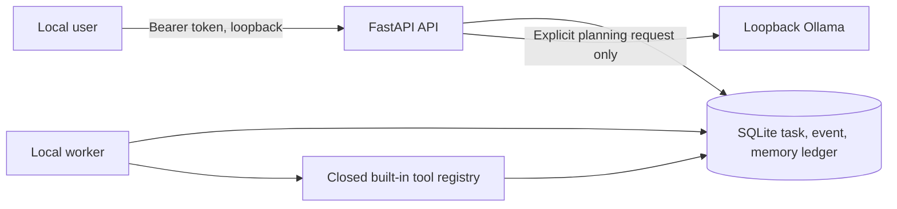

# Architecture

## Current implementation

At initial assessment, the linked GitHub repository had only a short README. During implementation it gained an ODIN architecture roadmap README, which this change preserves. The local workspace also contained `docs/Pack/odin_dev_pack`, a fictional contract challenge dataset, and `docs/Odin_PS.pdf`. Those files are preserved. No previous application code, database, frontend, tests, or deployment system existed.

The local runtime owns prompts, plans, memories, approvals, events, and audit records. API handlers validate requests and owner scope. The worker claims one step at a time with a lease, records its state before execution, and persists the result. Completed steps are skipped after a restart. The available tools are pure text operations and a transactional memory write. There is no arbitrary shell, file, or web tool.

This is a single-user local runtime with an owner identifier for data isolation tests. It does not offer real multi-user authentication or a cloud control plane. The API is bound to loopback by the CLI. Directly deploying it to a public network is unsupported.

## Decisions

- [ADR 0001](ADR/0001-local-runtime.md): Start with a local FastAPI runtime and SQLite ledger.
- [ADR 0002](ADR/0002-bounded-tools.md): Restrict execution to reviewed built-in tools.

## Next architecture step

Add a separately deployable control plane with independent identity, organization membership, and runtime registration. All cloud synchronization must be opt-in metadata with a documented schema. Private content remains local unless a user explicitly authorizes transfer.

